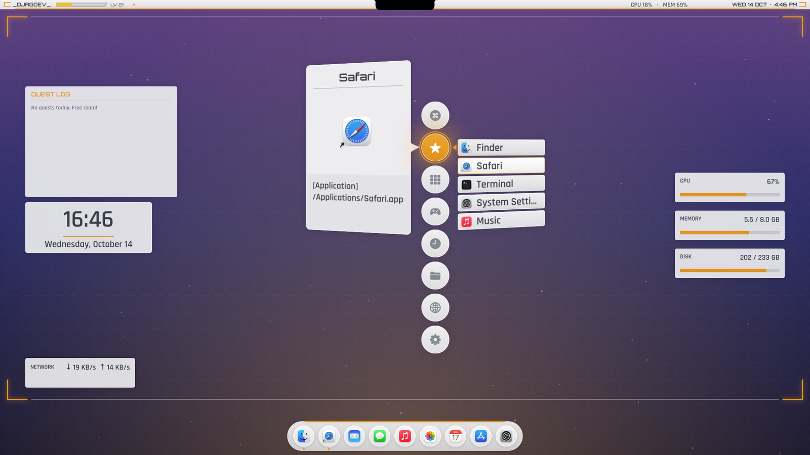
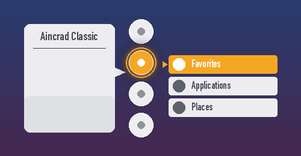
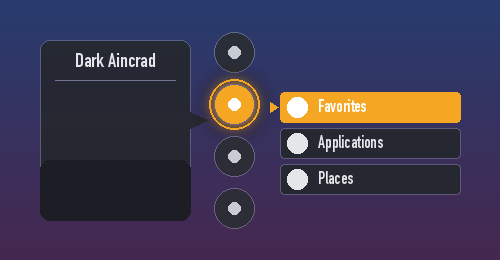
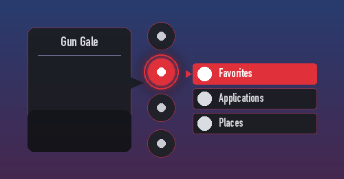
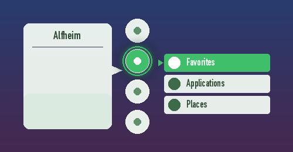

# AINCRAD

**The Sword Art Online system menu, on your Mac.**

Press <kbd>⌥</kbd> <kbd>`</kbd> (or swipe down on a Magic Mouse) and a column of glowing circles
drops in beside your pointer. Pick one and the menu cascades out to the side, exactly like the
floating menu in SAO. From there you can launch apps and games, search your Mac, read your
calendar as a quest log, and run the menus of whatever app you were just using.

It's a native Swift app, built on AppKit and Core Animation. It doesn't use web views or
third-party libraries, and it's light enough to leave running all day on an old Intel Mac mini.



> Unofficial fan project. Not affiliated with Sword Art Online or its rights holders.

---

## What it does

**The launcher.** Root circles, cascading columns, an info panel, sounds and SAO-style
animation. Type while it's open to search apps, files, menu items and System Settings, or to do
quick maths. Right-click anything for actions like Show in Finder, Quit or Add to Favorites.

**A HUD that opens with it.** Corner brackets sweep out to the edges of the screen, and your HUD
widgets slide in: a clock, CPU/memory/disk gauges, a quest log of today's events and reminders
(the next one is the *Floor Boss*), and anything else you add. HUD opacity is adjustable,
per widget and for the whole layer.

**Its own top bar and dock.** While the launcher is open, an SAO bar sits over the menu bar.
It shows your name, HP and level, the app you came from, and the time. Click your name to get
that app's real menus (File, Edit, View…). Right-click the bar for your menu bar icons
(Wi-Fi, sound, Bluetooth), and right-click the dock for an app's windows, Hide and Quit.
Apple's Dock and menu bar can stay hidden the whole time AINCRAD runs.

**Widgets on the desktop.** Clocks, stat bars, SAO HP bars, a game shelf with cover art, app
buttons, text and images. Drag them around, resize, rotate, and save layouts per display.

**Themes.** Every colour, size, curve and animation timing lives in a theme file. It ships with
Aincrad Classic (white and orange, like the show) and a dark version, and more are a click away.

| | | | |
|:-:|:-:|:-:|:-:|
|  |  |  |  |
| Aincrad Classic | Dark Aincrad | Gun Gale | Alfheim |

**Extensions you build with blocks.** The Extension Studio uses Scratch-style blocks: "when
Steam opens → switch theme to Gun Gale", or "every 5 seconds → set the HP gauge to free CPU".
Sixteen extensions come preinstalled (settings shortcuts, quick folders, player stats, a break
reminder, dice and more), and the [community catalog](https://github.com/djag1337/AINCRAD-catalog)
has more you can install from inside the app.

**A game shelf.** Steam (every library folder), Heroic (GOG and Epic), Prism Launcher instances
and regular game apps, all in one Games menu.

---

## Where it's heading

The long-term plan is a full **shell replacement**: quick SAO menus for everything you do on a
Mac. That means system controls (sound, Wi-Fi, brightness, Focus), changing settings without
opening System Settings, new reminders and events, quick notes, files, windows and media, all
without leaving the menu. [docs/ROADMAP.md](docs/ROADMAP.md) has the plan and what macOS allows.

---

## Getting started

You'll need macOS 14 or newer, Xcode 16, and [XcodeGen](https://github.com/yonaskolb/XcodeGen).

```sh
brew install xcodegen
git clone https://github.com/djag1337/AINCRAD.git
cd AINCRAD
./scripts/build.sh
```

That builds a Release copy and installs it to `/Applications/AINCRAD.app`. Open it and a small
◎ appears in your menu bar (there's no Dock icon). Press <kbd>⌥</kbd> <kbd>`</kbd> to open the
menu.

From there:

- **Settings** live under the ◎ menu, or under the ⚙ circle inside the launcher.
- **Change the menu** in Settings › Menu (drag to reorder, nest submenus, add apps, folders,
  websites or Shortcuts).
- **Add widgets** in Settings › Widgets. The *Add to* switch puts them on the desktop or in the HUD.
- **Turn on extensions** in Settings › Extensions. Their menus show up under
  Command Center › Extensions.

Building on a different Mac? Change `DEVELOPMENT_TEAM` in `project.yml` to your own team, or
set `CODE_SIGN_IDENTITY: "-"` for an unsigned local build. [docs/DEVELOPMENT.md](docs/DEVELOPMENT.md)
has the details.

---

## Q&A

**Is this SAO Utils for Mac?**
It's inspired by it, but it's written from scratch for macOS. SAO Utils plug-ins are Windows
code, so they can't run here. The block-based extensions are the Mac equivalent, and they're a
lot easier to make.

**Does it slow my Mac down?**
It's designed not to. Nothing animates or polls while the launcher is closed, widgets stop
sampling when they're covered, and the launcher opens in a few milliseconds.
[docs/PERFORMANCE.md](docs/PERFORMANCE.md) has the measurements.

**Why does it ask for Accessibility access?**
For the features that need to see or press things in other apps: the mouse gesture, reading an
app's menus for the top bar, listing windows in the dock, and mirroring notifications as SAO
bubbles. Everything else works without it.

**Why does it want my Calendar and Reminders?**
Only for the quest log widget. Remove that widget and it never reads either.

**Can it hide Apple's Dock and menu bar?**
Yes. Settings › General › AINCRAD Shell. Your original settings are saved first and come back
when you turn it off or quit.

**Are extensions safe to install?**
Extensions are data, not code. A script is a tree of blocks that AINCRAD's own interpreter runs
with step, time and loop limits. Anything that touches the network or files outside the
extension has to ask, and you approve it when you turn the extension on. Catalog downloads are
checked against a SHA-256.

**How do I make a theme or an extension?**
Themes: Settings › Themes, change anything, then Export. Extensions: open the Extension Studio
from the ◎ menu, snap blocks together, press ▶ to test, then Publish.
The docs cover [themes](docs/THEMES.md) and [extensions](docs/EXTENSIONS.md) in full.

**Something broke and it won't open properly.**
Hold <kbd>⌥</kbd> while launching to start in Safe Mode. AINCRAD also switches to Safe Mode by
itself after two quick crashes. Logs are in `~/Library/Application Support/AINCRAD/logs/`.

**Is it on the App Store?**
No. It needs things the App Store sandbox doesn't allow (global hotkeys, reading other apps'
menus, hiding the Dock), so for now you build it yourself.

---

## Docs

- [Configuration and menus](docs/CONFIGURATION.md)
- [Themes](docs/THEMES.md)
- [Widgets](docs/WIDGETS.md)
- [Extensions and the block language](docs/EXTENSIONS.md)
- [Roadmap](docs/ROADMAP.md): the plan for a full shell replacement
- [Feature status](docs/STATUS.md): what's tested, what isn't, and known limitations
- [Performance](docs/PERFORMANCE.md)
- [Developing](docs/DEVELOPMENT.md): building, signing, tests and project layout
- [Changelog](CHANGELOG.md)

## Credits

Made by **DjagDev**. The Rajdhani and Orbitron fonts are bundled under the
SIL Open Font License (see `AINCRAD/Resources/Fonts`). Sounds and the app icon are original.
